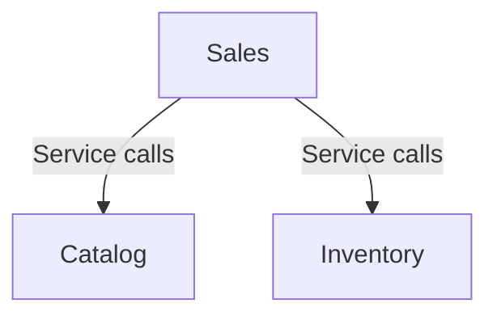
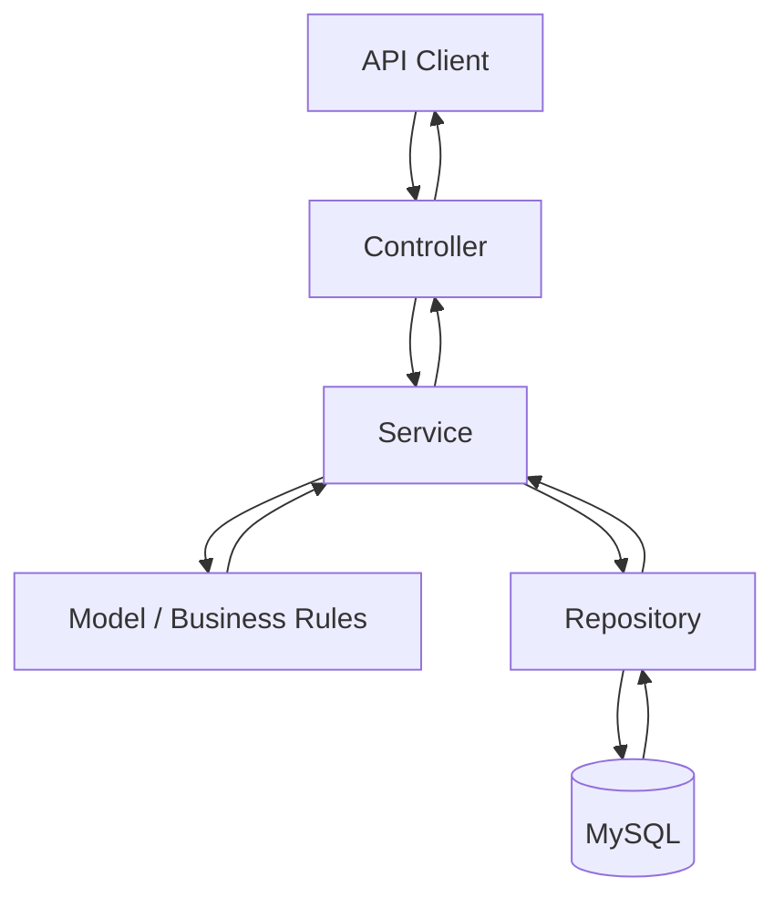

# Architecture

## 1. Architectural Style

The application follows a **modular monolith** architecture built with Java 17 and Spring Boot.

The system is organized into business-oriented modules within a single application. Each module groups responsibilities related to a specific business capability, while interactions between modules are handled through service-level calls.

This structure separates business responsibilities without introducing the operational complexity of independently deployed services.

## 2. Module Organization

The application is organized into the following business modules:

| Module | Internal Components | Responsibility |
|---|---|---|
| `iam` | `user`, `authentication`, `role` | User identity, authentication, and authorization. |
| `catalog` | `brand`, `category`, `product` | Product catalog, categories, brands, and product-related information. |
| `customer` | `customer` | Customer information and related operations. |
| `inventory` | `stock` | Stock management and inventory operations. |
| `sales` | `cart`, `checkout`, `order` | Shopping carts, checkout, and order management. |

The source code is organized by business module, with internal packages separating responsibilities such as application services, domain models, persistence, and HTTP presentation where applicable.

```text
br.com.jogatinastore/
├── iam/
│   ├── user/
│   ├── authentication/
│   └── role/
├── catalog/
│   ├── brand/
│   ├── category/
│   └── product/
├── customer/
│   └── customer/
├── inventory/
│   └── stock/
├── sales/
│   ├── cart/
│   ├── checkout/
│   └── order/
├── config/
│   ├── openapi/
│   └── security/
├── observability/
│   ├── logging/
│   ├── metrics/
│   └── tracing/
└── shared/
    ├── exception/
    ├── pagination/
    └── utils/
```

Additional packages support cross-cutting concerns and shared functionality:

- `config`: application configuration, including security and API documentation setup.
- `observability`: application logging and related observability configuration.
- `shared`: reusable components, including exception handling, pagination, and utilities.

Database migration scripts are maintained under `src/main/resources/db/migration/`.

The exact responsibilities of supporting packages should be understood from their current implementations.

## 3. Module Dependencies

Modules interact through service-level calls rather than accessing another module's repositories directly.

The `sales` module depends on services provided by `catalog` and `inventory` to retrieve product information and perform stock-related operations.

At a high level, the main dependencies are:



The modules share a MySQL database. The modular organization therefore represents a separation of business responsibilities within the application, not independent databases or independently deployable services.

Module boundaries are maintained through the application's code organization and dependency conventions. Automated architectural tests enforcing these boundaries are not currently documented.

## 4. Application Structure

Each business module contains components responsible for its operations, including controllers, services, repositories, and other supporting classes where applicable.

The typical request flow is:



Controllers expose HTTP endpoints, services coordinate application operations and business rules, and repositories handle database access through Spring Data JPA.

Cross-module interactions use services exposed by the relevant module. For example, checkout coordinates operations involving product information and stock availability.

API documentation is defined separately from controller implementations to keep endpoint documentation concerns out of controller code.

## 5. Data and Persistence

The application uses **MySQL** as its relational database and **Spring Data JPA with Hibernate** for persistence.

Flyway manages database schema changes through versioned SQL migration scripts organized by business domain.

The modules share the same database. Their organization in the codebase does not imply separate database instances or complete data isolation.

Business operations that modify related data use Spring transaction management where configured. Checkout, for example, coordinates cart validation, stock operations, and order creation within a transaction.

## 6. Key Architectural Decisions

The following decisions are documented at a high level here. Their implementation details, rationale, and trade-offs belong in [`engineering-decisions.md`](engineering-decisions.md).

- **Modular monolith:** business responsibilities are organized into modules within one application.
- **Service-level module interactions:** cross-module operations use services rather than direct access to another module's repositories.
- **Dynamic product filtering:** Spring Data JPA Specifications support combinations of optional product filters.
- **Conditional stock updates:** stock updates include an availability condition in the database operation.
- **Transactional checkout:** checkout coordinates multiple business operations within a transaction.
- **Domain-oriented migrations:** Flyway scripts organize schema changes by business domain.
- **Separate API documentation:** endpoint documentation is maintained separately from controller implementations.

## 7. Current Limitations

The architecture and its supporting capabilities are still evolving.

- Payment processing and the complete payment lifecycle have not yet been implemented.
- Automated deployment is not currently implemented.
- Metrics and distributed tracing are planned but are not yet implemented.
- Test coverage is concentrated on selected cart and checkout scenarios and does not yet cover every module or persistence concern.
- Module boundaries are maintained through code organization and conventions; automated architectural enforcement has not been established.

These limitations describe the current state of the project and may change as implementation progresses.